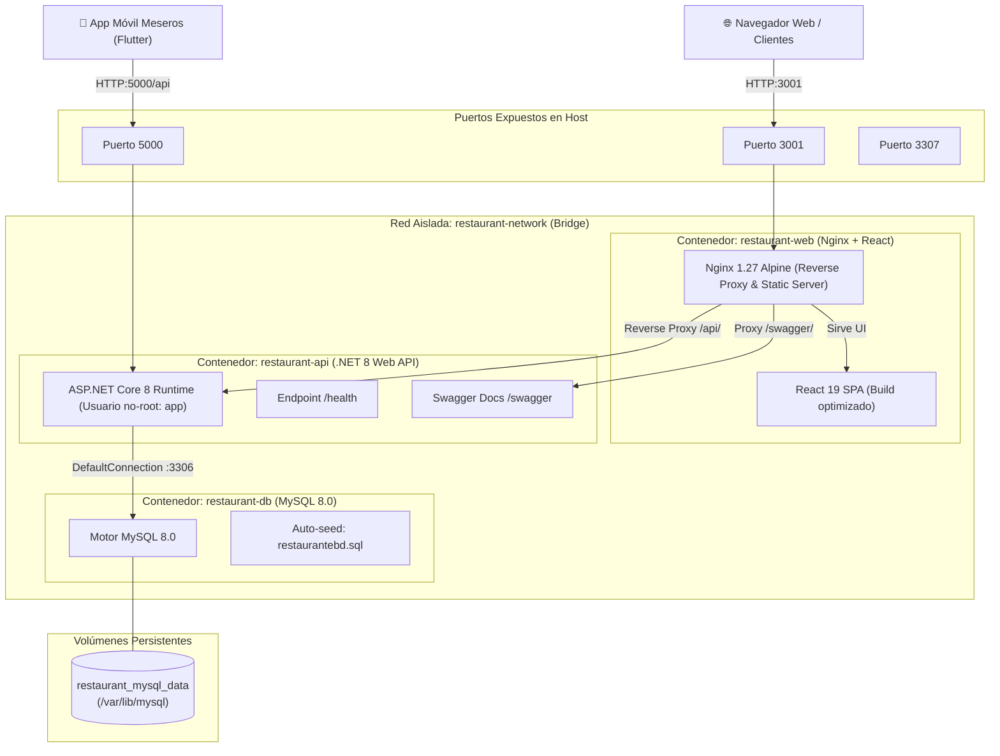

# 🐳 Arquitectura de Contenedores Docker - RestaurantApp (Qpro)

Este documento detalla la arquitectura de contenedores implementada para el proyecto **RestaurantApp**, siguiendo los principios de **separación de responsabilidades (SoC)**, **seguridad por capas**, **construcciones multi-etapa (multi-stage builds)** y **orquestación declarativa**.

---

## 🏗️ 1. Diagrama de Arquitectura de Contenedores



---

## 🧩 2. Componentes y Separación de Capas

### 🟢 Capa 1: Base de Datos (`restaurant-db`)
* **Imagen base:** `mysql:8.0`
* **Persistencia:** Volumen nombrado `restaurant_mysql_data` montado en `/var/lib/mysql` para garantizar que los datos sobrevivan al ciclo de vida de los contenedores.
* **Auto-Aprovisionamiento:** El script oficial `restaurantebd.sql` está montado en `/docker-entrypoint-initdb.d/01-init.sql:ro`, lo que crea las tablas y carga los datos de prueba automáticamente en el primer arranque.
* **Configuración personalizada:** `docker/mysql/my.cnf` define codificación `utf8mb4`, zona horaria `-05:00` y optimizaciones InnoDB.
* **Healthcheck:** Monitorea la disponibilidad del servicio usando `mysqladmin ping` antes de permitir que la API intente conectarse.
* **Puerto Host:** Mapeado al puerto `3307:3306` para evitar colisiones con instancias locales de MySQL instaladas en la máquina.

### 🔵 Capa 2: Backend API (`restaurant-api`)
* **Tecnología:** ASP.NET Core 8 Web API.
* **Multi-stage Dockerfile:**
  1. *Etapa Builder (`mcr.microsoft.com/dotnet/sdk:8.0`):* Copia solo `.csproj` primero para aprovechar la caché de Docker en la restauración de paquetes NuGet. Luego compila y publica en modo `Release`.
  2. *Etapa Runner (`mcr.microsoft.com/dotnet/aspnet:8.0`):* Imagen base mínima de runtime Debian sin el SDK completo.
* **Seguridad:** Ejecuta bajo el usuario no privilegiado integrado `app` (`USER app`).
* **Healthcheck:** Endpoint nativo `/health` verificado con `curl`.
* **Resiliencia de arranque:** Depende de `restaurant-db` con `condition: service_healthy`, asegurando que no haya errores de conexión al arrancar.
* **Puerto Host:** Mapeado al puerto `5000:5000`.

### 🟣 Capa 3: Frontend Web (`restaurant-web`)
* **Tecnología:** React 19 + Nginx 1.27 Alpine.
* **Multi-stage Dockerfile:**
  1. *Etapa Builder (`node:20-alpine`):* Instala dependencias con `npm ci --legacy-peer-deps` y genera el bundle estático de producción con `PUBLIC_URL=/`.
  2. *Etapa Runner (`nginx:1.27-alpine`):* Servidor web de alto rendimiento ultraligero (~25MB).
* **Nginx Reverse Proxy:**
  - Las peticiones a `/api/` se reenvían internamente a `http://restaurant-api:5000/api/`. Esto **elimina por completo los problemas de CORS** en el navegador y simplifica la configuración de dominios e IPs.
  - Proxy para `/swagger/`.
  - Compresión Gzip activada para HTML, JS, CSS y JSON.
  - Caché inmutable para archivos estáticos con hash (`/static/`).
  - Fallback SPA para evitar errores 404 al recargar páginas (`try_files $uri $uri/ /index.html`).
* **Puerto Host:** Mapeado al puerto `3001:80`.

### 📱 Capa 4: App Móvil (`app/restaurant_app` - Flutter)
* La aplicación móvil para meseros está construida en Flutter para ejecutarse en dispositivos Android / iOS o emuladores.
* **Conexión a los contenedores:**
  - En emulador Android: `http://10.0.2.2:5000`
  - En dispositivo físico conectado a la misma red WiFi: `http://<IP_LOCAL_DE_TU_PC>:5000` (ejemplo: `http://192.168.1.100:5000`)
  - A través de túnel / ngrok: `https://tu-subdominio.ngrok-free.dev`

---

## 🚀 3. Guía de Ejecución Rápida

### Opción A: Usando scripts automáticos (Recomendado)

* **En Windows:**
  - Para iniciar: doble clic en `docker-start.bat` o ejecutar `.\docker-start.bat`
  - Para detener: doble clic en `docker-stop.bat`
  - Para ver logs: doble clic en `docker-logs.bat`

* **En Linux / macOS / WSL:**
  ```bash
  chmod +x docker-start.sh
  ./docker-start.sh
  ```

### Opción B: Usando comandos estándar de Docker Compose

```bash
# 1. Construir las imágenes y levantar los contenedores en segundo plano
docker compose up -d --build

# 2. Verificar el estado de salud de los servicios
docker compose ps

# 3. Ver los logs en tiempo real
docker compose logs -f

# 4. Detener todos los servicios
docker compose down

# 5. Detener y eliminar volúmenes (reiniciar la BD desde cero)
docker compose down -v
```

---

## 🌐 4. URLs de Acceso

| Servicio | URL Local | Descripción |
| :--- | :--- | :--- |
| **Frontend Web** | [http://localhost:3001](http://localhost:3001) | Panel administrativo y cocina de RestaurantApp |
| **Backend API (Swagger)** | [http://localhost:5000/swagger](http://localhost:5000/swagger) | Documentación interactiva OpenAPI/Swagger |
| **Healthcheck API** | [http://localhost:5000/health](http://localhost:5000/health) | Verificación de estado del backend |
| **Base de Datos MySQL** | `localhost:3307` | Conexión externa (DBeaver, MySQL Workbench, etc.) |

*Credenciales de Base de Datos por defecto:*
- **Host:** `localhost` (puerto `3307` en host, `3306` dentro de Docker)
- **Base de datos:** `restaurantebd`
- **Usuario:** `root`
- **Contraseña:** `root`

---

## 🛡️ 5. Buenas Prácticas Implementadas

1. **Builds Multi-Etapa (Multi-Stage):** Las imágenes finales solo contienen los artefactos necesarios para ejecución, sin herramientas de compilación pesadas (SDK de .NET o Node.js), reduciendo el tamaño y superficie de ataque.
2. **Principio de Menor Privilegio (Non-root user):** El contenedor de la API corre con el usuario seguro `app`.
3. **Healthchecks Declarativos y Dependencias Fuertes:** La API espera activamente que MySQL esté completamente inicializado y saludable antes de iniciar.
4. **Reverse Proxy Nginx Unificado:** Evita CORS, centraliza cabeceras de seguridad (`X-Frame-Options`, `X-Content-Type-Options`) y gestiona compresión y caché.
5. **Aislamiento de Red:** Red dedicada `restaurant-network` de tipo bridge.
6. **Gestión de Configuración vía Variables de Entorno (`.env`):** Ningún secreto sensible hardcodeado; puertos y credenciales configurables desde `.env`.
7. **Persistencia Segura de Datos:** Volúmenes nombrados desacoplados del ciclo de vida del contenedor.
