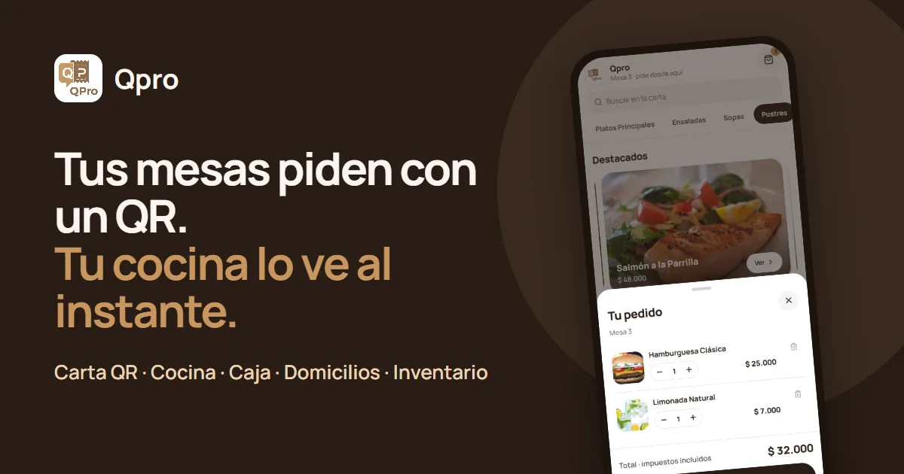
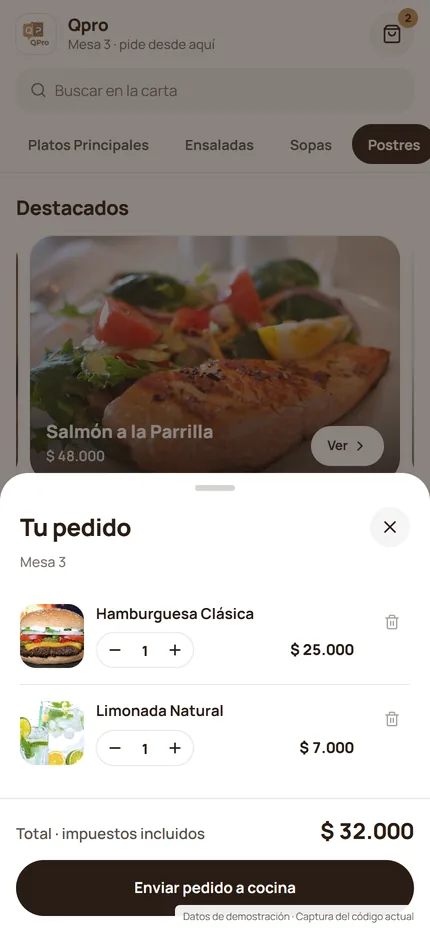
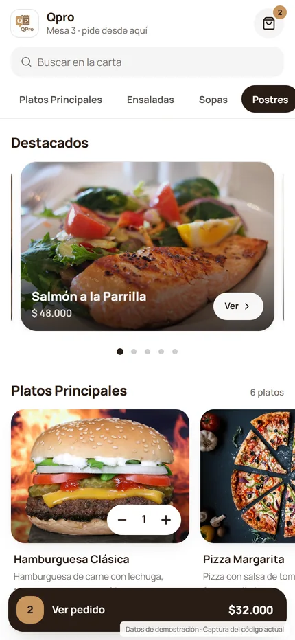
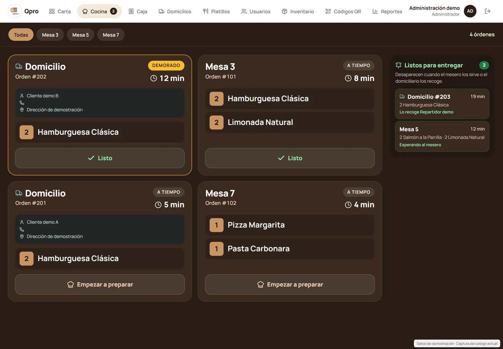
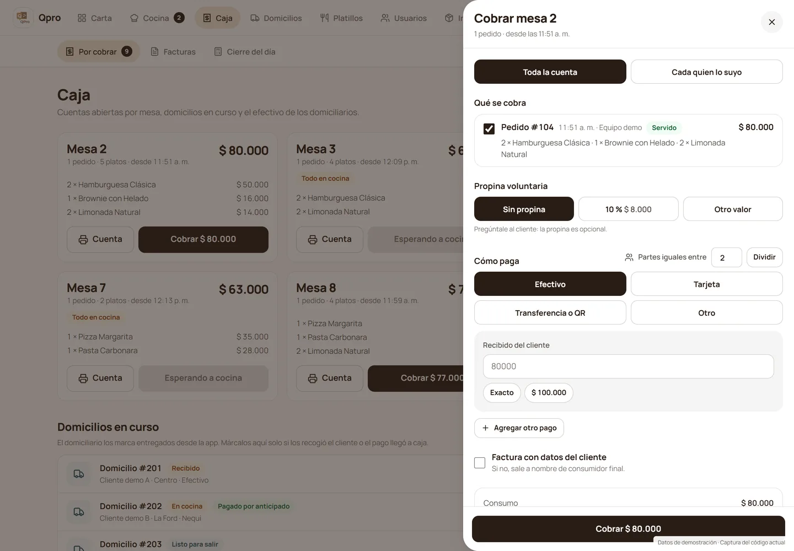
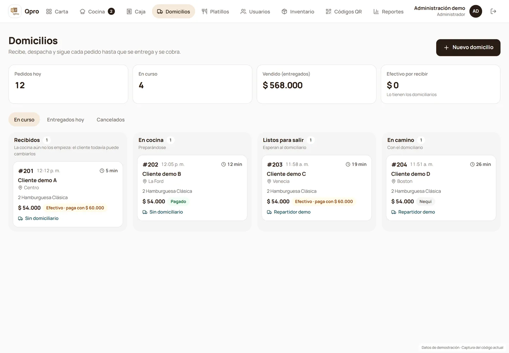
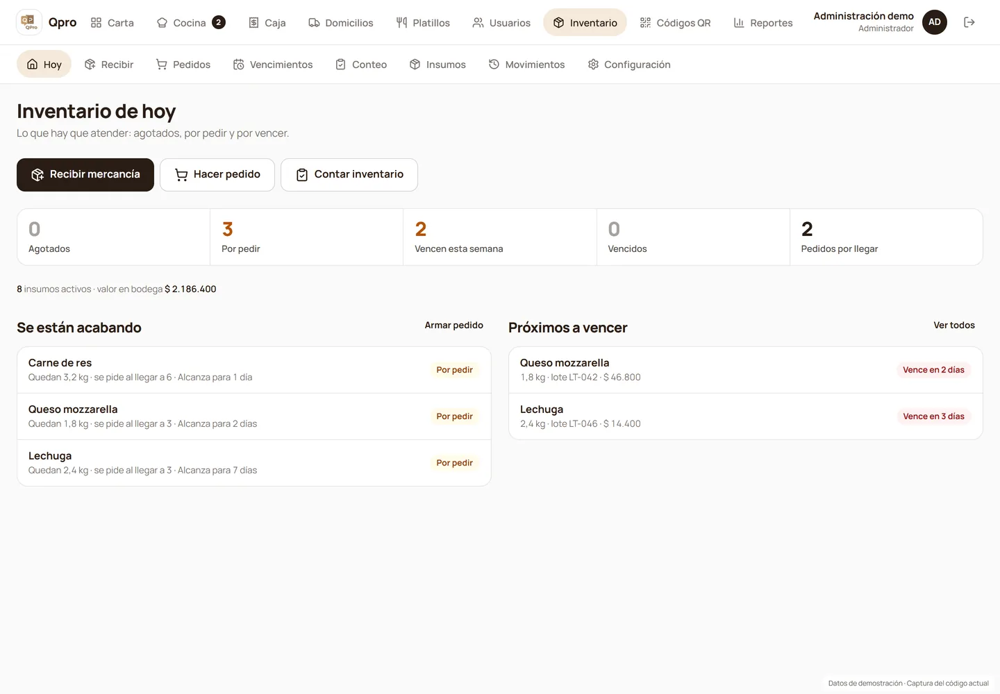
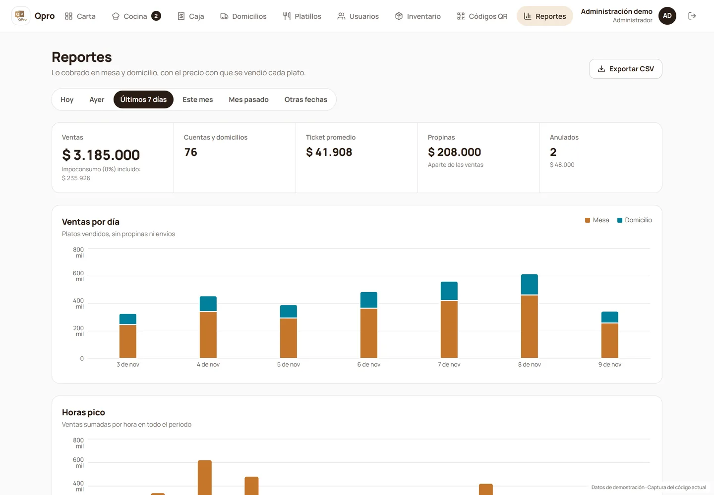
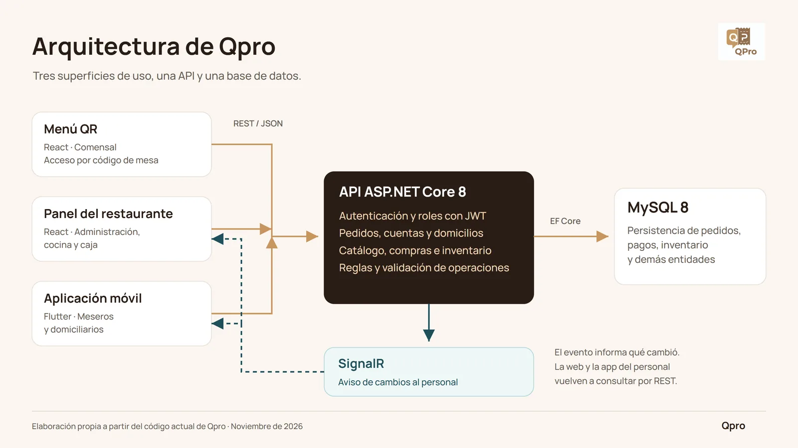
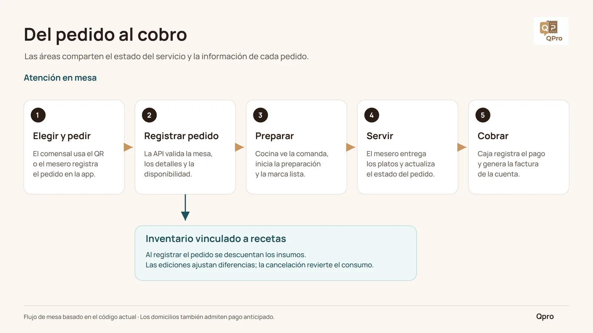

<div align="center">



<h1>Qpro</h1>

<p><strong>Menú QR, cocina, caja, domicilios e inventario para restaurantes, en un solo sistema.</strong></p>

<p>
  <a href="https://empresascol.github.io/RestaurantApp/landing/"><strong>Conoce Qpro</strong></a> ·
  <a href="https://empresascol.github.io/RestaurantApp/">Acceso del personal</a> ·
  <a href="https://wa.me/573018049468">Agenda una demo</a>
</p>

<p>
  
  
  
  
  
  
</p>

</div>

---

## Qué es Qpro

Qpro digitaliza la operación de un restaurante independiente. El comensal escanea el código QR de su mesa y pide desde el celular, sin instalar nada. El pedido llega al instante a la pantalla de cocina, la cuenta se arma sola en caja y cada plato descuenta del inventario los ingredientes de su receta.

Nació como proyecto de grado en la **Corporación Universitaria del Caribe (CECAR)**, en Sincelejo, y funciona de punta a punta: web, API, app móvil y base de datos.

| Módulo | Qué resuelve |
|---|---|
| 📱 **Carta QR por mesa** | Fotos, categorías, buscador y platos agotados marcados solos. |
| 👨‍🍳 **Pantalla de cocina** | Comandas de mesa y domicilio con tiempo por orden y aviso al mesero. |
| 💵 **Caja** | Cuenta por mesa, cuenta dividida, propina, varios medios de pago, facturas y cierre del día. |
| 🛵 **Domicilios** | Etapas visibles para todos y app para el domiciliario: llamar, ver el mapa y cobrar. |
| 📦 **Inventario por recetas** | Compras, proveedores, lotes, vencimientos y alertas de stock bajo. |
| 📊 **Reportes** | Ventas por día, horas pico, ticket promedio y exportación en CSV. |

## Así se ve

<table>
  <tr>
    <td width="50%" align="center"><br><sub><b>Carta QR</b> · el comensal arma su pedido</sub></td>
    <td width="50%" align="center"><br><sub><b>Pedido en curso</b> · sin descargar ninguna app</sub></td>
  </tr>
  <tr>
    <td><br><sub><b>Cocina</b> · comandas claras, de lejos</sub></td>
    <td><br><sub><b>Caja</b> · la cuenta lista antes de que la pidan</sub></td>
  </tr>
  <tr>
    <td><br><sub><b>Domicilios</b> · del fogón a la puerta</sub></td>
    <td><br><sub><b>Inventario</b> · lo que vendes se descuenta solo</sub></td>
  </tr>
  <tr>
    <td colspan="2" align="center"><br><sub><b>Reportes</b> · cuánto vendiste, sin hacer cuentas</sub></td>
  </tr>
</table>

<sub>Capturas de la versión actual con datos de demostración.</sub>

## Arquitectura



| Capa | Tecnología | Carpeta |
|---|---|---|
| **API** | ASP.NET Core 8, EF Core (Pomelo MySQL), JWT, SignalR, Firebase Cloud Messaging | [`api/RestaurantApi`](api/RestaurantApi) |
| **Web** | React 19, Motion, React Router | [`web/mi-restaurante`](web/mi-restaurante) |
| **App móvil** | Flutter (meseros y domiciliarios) | [`app/restaurant_app`](app/restaurant_app) |
| **Base de datos** | MySQL en desarrollo, TiDB Cloud en producción | [`restaurantebd.sql`](restaurantebd.sql), [`migraciones`](migraciones) |
| **Landing** | React prerenderizado, WebP, GitHub Pages | [`landing`](landing) |
| **Pruebas** | xUnit, Jest y flutter_test | [`tests`](tests) |

### Del pedido al cobro



## Estructura del repositorio

```
RestaurantApp/
├── api/RestaurantApi/     API REST + hub de SignalR
├── web/mi-restaurante/    menú QR, cocina, caja y administración
├── app/restaurant_app/    app Flutter de meseros y domiciliarios
├── landing/               página comercial (empresascol.github.io/RestaurantApp/landing)
├── tests/                 pruebas de la API y planes de prueba manuales
├── migraciones/           scripts SQL por fecha
├── docker/                configuración de MySQL para los contenedores
├── docs/readme/           imágenes de este README
└── docker-compose.yml     base de datos, API y web en contenedores
```

## Cómo ejecutarlo

### Con Docker (recomendado)

```bash
cp .env.example .env        # completa JWT_KEY y las claves de la base de datos
docker compose up -d --build
```

| Servicio | Dirección |
|---|---|
| Web | http://localhost:3001 |
| API | http://localhost:5000/api |
| MySQL | `localhost:3307` (se llena sola con `restaurantebd.sql`) |

Los detalles de los contenedores están en [`DOCKER_ARCHITECTURE.md`](DOCKER_ARCHITECTURE.md).

### Sin Docker

Necesitas .NET 8, Node 20 o superior, Flutter 3 y MySQL 8 con `restaurantebd.sql` importado.

```bash
# API en http://localhost:5000 (conexión en appsettings.Development.json)
ASPNETCORE_ENVIRONMENT=Development dotnet run --project api/RestaurantApi

# Web en http://localhost:3000
cd web/mi-restaurante && npm install && npm start

# App móvil apuntando a tu API (10.0.2.2 es el computador visto desde el emulador de Android)
cd app/restaurant_app && flutter pub get && flutter run --dart-define=API_BASE_URL=http://10.0.2.2:5000
```

## Pruebas

```bash
# API
dotnet test tests/RestaurantApi.Tests

# Web
cd web/mi-restaurante && npm test -- --watchAll=false

# App móvil
cd app/restaurant_app && flutter test

# Landing (con npm start corriendo en otra terminal)
cd landing && npm test
```

Más detalle en [`tests/README.md`](tests/README.md).

## Despliegue

| Parte | Dónde | Cómo |
|---|---|---|
| API | Render | `https://qpro-api-oi8l.onrender.com` |
| Base de datos | TiDB Cloud | Corre cada script de `migraciones/` antes de desplegar la API que lo usa |
| Web | GitHub Pages | `cd web/mi-restaurante && npm run deploy` |
| Landing | GitHub Pages | `cd landing && npm run deploy` |

La web y la landing comparten la rama `gh-pages`; cada una reemplaza solo sus propios archivos.

## Documentación

- [`PRODUCT.md`](PRODUCT.md): usuarios, propósito y principios del producto.
- [`DESIGN.md`](DESIGN.md): colores, tipografía y componentes de Qpro.
- [`CONTEXTO_PROYECTO.md`](CONTEXTO_PROYECTO.md): estado actual, decisiones y pendientes.
- [`landing/README.md`](landing/README.md): cómo editar y publicar la página comercial.

## Equipo

Proyecto de grado de la Corporación Universitaria del Caribe (CECAR), Sincelejo, 2026.

- Abrahan Jussep Badel Palmett
- Mateo Villalobos
- Juan Morales

<div align="center">
<br>
<a href="https://wa.me/573018049468"></a>
<br><br>
<sub>Hecho en Sincelejo, Colombia.</sub>
</div>
